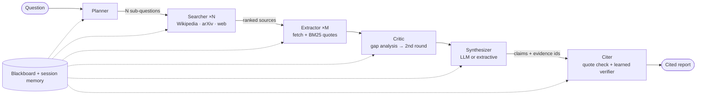

<div align="center">

# 🧠 Cortex Research

**A multi-agent research assistant that plans, searches, extracts, critiques, synthesizes — and verifies every claim against a real source quote.**

[](https://github.com/YOUR_USERNAME/cortex-research/actions)


</div>

<!-- Add a screenshot or GIF here: docs/demo.gif -->

Single-prompt LLMs hallucinate and skip citations; manual deep research is slow. Cortex Research orchestrates **six specialised agents** over a shared blackboard and treats **verification as a first-class stage**: a claim reaches the report only if its quote exists in the source *and* a trained classifier judges it supported.

## Features

- **Real orchestration, not prompt-chaining** — typed hand-offs, parallel fan-out, shared blackboard, per-agent tool permissions (least privilege).
- **Citation-verified reports** — fabricated quotes and unsupported claims are dropped; every report ships a grounding score.
- **Learned claim verifier** — scikit-learn gradient-boosted model that catches negation, antonym, number and entity flips that word-overlap misses.
- **Self-correcting** — a Critic agent finds thin sub-questions, rewrites queries, and runs a second search round.
- **Resilient** — exponential backoff + jitter, `Retry-After` handling, TTL cache, per-host rate limits, graceful degradation (LLM → extractive), explicit failure states.
- **Works with zero API keys** (deterministic extractive mode); add an Anthropic or OpenAI-compatible key for generative planning and synthesis.
- **Observable** — every event (start / end / retry / warn / metric) streams over SSE to a live UI and persists to `runs/<id>.jsonl`.
- **Session memory** — follow-up questions reuse earlier evidence.
- **n8n-ready** — synchronous webhook endpoint plus a sample workflow.
- **Polished UI** — animated agent graph, live trace, per-agent timeline, hover-to-see-quote citations, Markdown export. Rendered with DOM APIs only (no `innerHTML`), so scraped text can't inject markup.

## Architecture



| Agent | Responsibility | Tools |
|---|---|---|
| **Planner** | Decompose the question into facet sub-questions | — |
| **Searcher** | Find candidate sources per sub-question (parallel) | `wikipedia_search`, `arxiv_search`, `web_search` |
| **Extractor** | Fetch pages, pull verbatim passages (BM25, optional LLM filter) | `wikipedia_text`, `fetch_page` |
| **Critic** | Detect uncovered sub-questions, reformulate, re-search | search + fetch |
| **Synthesizer** | Write findings from evidence only | — |
| **Citer** | Verify quote presence + claim support; number citations | — |

## Quick start

```bash
git clone https://github.com/YOUR_USERNAME/cortex-research.git && cd cortex-research
python3 -m venv .venv && source .venv/bin/activate
pip install -r requirements.txt
cp .env.example .env          # optional: add ANTHROPIC_API_KEY or OPENAI_API_KEY
uvicorn cortex_research.server:app --port 8000
```

Open <http://localhost:8000>. No keys needed to try it.

## Learned claim verifier

A `GradientBoostingClassifier` over 13 alignment features (token/bigram overlap, sequence ratio, new numbers and entities, negation mismatch, antonym flips, …) scores whether a quote supports a claim.

**Training data:** Wikipedia sentences with synthetic positives (verbatim, first clause, parenthetical-stripped) and adversarial negatives (negation, antonym, number change, entity swap, off-topic, unsupported add-on clause). Split **by article** to avoid leakage.

| Held-out set | F1 | Accuracy |
|---|---|---|
| Word-overlap baseline (previous rule) | 0.63 | 0.67 |
| **Learned verifier** | **0.998** | **0.999** |

The baseline scores 0% on negation / antonym / number / entity flips; the learned model fixes them (per-type results in `models/verifier_metrics.json`).

> **Limitations — read before citing these numbers.** This is a *synthetic* benchmark generated from the same perturbations the features target, built from only 10 Wikipedia articles (2,645 train / 1,112 test pairs). Near-ceiling scores show the model handles those failure modes, **not** that it solves general entailment. Evaluating on a real dataset (SciFact / MNLI) is the next step.

Retrain: `python -m cortex_research.train_verifier`

## Evaluation

`python -m eval.run_eval` runs 8 diverse questions end to end (extractive mode, no keys):

| Metric | Result |
|---|---|
| Runs completed | 8 / 8 |
| Mean grounding | 100% |
| Median wall time | ~61 s |
| Mean sources cited | 6.6 |
| Transient failures absorbed by retries | 45 |

Grounding is 100% in extractive mode by construction (claims are verbatim quotes); it becomes a meaningful metric in generative mode. Latency is dominated by public-API rate limits (Wikipedia, arXiv, DuckDuckGo). Raw results: `eval/results.json`.

## API

| Method | Endpoint | Description |
|---|---|---|
| `POST` | `/api/runs` | Start a run `{question, depth: quick\|standard\|deep, session_id}` |
| `GET` | `/api/runs/{id}/events` | Live event stream (SSE) |
| `GET` | `/api/runs/{id}` | Run status + final report JSON |
| `GET` | `/api/runs/{id}/report.md` | Report as Markdown |
| `POST` | `/api/webhook/n8n` | Synchronous run for n8n / Zapier |
| `GET` | `/api/model` | Verifier metadata and metrics |
| `GET` | `/api/health` | Health + active LLM provider |

## Project structure

```
cortex-research/
├── cortex_research/
│   ├── agents.py          # Planner, Searcher, Extractor, Critic, Synthesizer, Citer
│   ├── orchestrator.py    # Agent graph execution, events, failure handling
│   ├── tools.py           # Wikipedia / arXiv / web tools, cache, rate limits, permissions
│   ├── verifier.py        # Feature engineering + inference for the claim verifier
│   ├── train_verifier.py  # Data synthesis, training, held-out evaluation
│   ├── llm.py             # Anthropic / OpenAI-compatible / offline providers
│   ├── memory.py          # Blackboard + session memory
│   ├── resilience.py      # Retry with exponential backoff + jitter
│   ├── textutil.py        # Tokenisation, sentence split, BM25
│   ├── server.py          # FastAPI app + SSE
│   ├── config.py          # Settings + minimal .env loader
│   └── static/            # Web UI (HTML / CSS / vanilla JS)
├── models/                # Trained verifier + metrics
├── eval/                  # End-to-end evaluation harness + results
├── tests/                 # Unit + pipeline tests
├── n8n/                   # Sample n8n workflow
└── .github/workflows/     # CI
```

## Configuration

See [`.env.example`](.env.example). With no key set, Cortex runs in extractive mode; with `ANTHROPIC_API_KEY` (or `OPENAI_API_KEY` + optional `OPENAI_BASE_URL`) the Planner, Extractor filter, and Synthesizer become generative, with automatic fallback to extractive if the LLM call fails.

## Testing

```bash
pytest -q        # 9 tests: BM25, retries, tool permissions, citer verification, critic, full pipeline w/ failures, verifier
```

## Roadmap

- [ ] Evaluate / fine-tune the verifier on SciFact or MNLI
- [ ] Head-to-head benchmark vs. a single-prompt LLM (grounding, citation precision)
- [ ] Pluggable search providers (Tavily, Brave, Semantic Scholar)
- [ ] Persistent storage (SQLite/Postgres), auth, per-user rate limiting
- [ ] Embedding-based retrieval alongside BM25

## License

[MIT](LICENSE)
